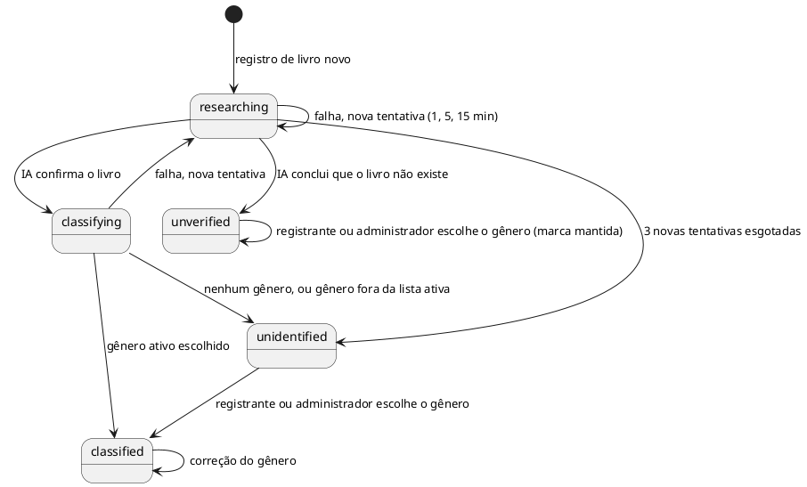

# Design — catalogo

## Abordagem

O contexto nasce no serviço `art-books` (Go, módulo `github.com/Arthur-155/art-books`,
binário em `backend/art-books/`, HTTP na porta `:8080`, PostgreSQL), no pacote
`backend/domain/catalogo/` com `//gofi:context catalogo`, nas camadas do SDK:
`entity`, `repository`, `service`, `handler`, mais `worker` (pesquisa em segundo
plano) e `researcher` (cliente da IA). Autenticação é a do SDK (JWT); o token
emitido por `contas` traz o id do usuário, o papel (`user` | `admin`) e se o
e-mail está confirmado (ADR-04).

O registro (REQ-01–04) normaliza título e autor no `service` e faz
`INSERT … ON CONFLICT ON CONSTRAINT uq_book_title_normalized_author_normalized DO NOTHING`;
sem linha inserida, lê o livro existente. A restrição no banco resolve o
registro simultâneo e garante uma pesquisa por livro, porque a pesquisa é o
próprio estado da linha (ADR-01). O `worker`, no mesmo binário, busca a cada
10 s os livros com pesquisa vencida, reserva cada um com `FOR UPDATE SKIP LOCKED`
e uma concessão de 5 min, chama a IA em dois passos (pesquisa e classificação)
e grava o resultado (REQ-05–08). A correção e a administração da lista são
operações síncronas do `service` (REQ-09–14).



A troca de gênero só vale fora de `researching` e `classifying` (REQ-09.5): o
`UPDATE` leva `WHERE research_status NOT IN ('researching','classifying')`, o
que fecha a corrida com o worker sem lock explícito. Em `unverified` o estado
não muda, só o `genre_id` (REQ-09.6); nos outros, passa a `classified`.

### Normalização (REQ-02)

Função pura `NormalizeBookText(string) string` em `entity`: decomposição NFD
(`golang.org/x/text/unicode/norm`) e remoção das marcas de acento (`unicode.Mn`),
`strings.ToLower`, `strings.Fields` + `strings.Join(…, " ")` para espaços
repetidos e `strings.TrimFunc` com `unicode.IsPunct` nas pontas, repetido até
estabilizar (pontuação e espaço alternados nas pontas). Texto vazio depois de
normalizar é dado inválido (REQ-01.2).

### Pesquisa em segundo plano (REQ-06–08)

| Passo | Estado antes | Chamada à IA | Resultado |
|---|---|---|---|
| Pesquisa | `researching` | Claude com a ferramenta de busca na web do servidor da Anthropic: o livro existe? resposta estruturada `{exists, summary}` | `exists=false` → `unverified`; `true` → `classifying` |
| Classificação | `classifying` | Claude com os nomes da lista ativa no prompt e saída estruturada `{genre: nome \| null}` | nome ativo → `classified` + `genre_id`; `null` ou fora da lista → `unidentified` |

- A escolha da IA é conferida pelo `service` contra a lista ativa **lida na
  hora de gravar**, nunca confiada à resposta (REQ-06.2).
- Falha = erro de rede, HTTP 5xx/429, timeout de 60 s ou resposta fora do
  formato. Cada falha incrementa `research_retries`; com `research_retries < 3`,
  `next_attempt_at = now() + {1, 5, 15} min` conforme o número da falha e o
  estado volta a `researching`; na quarta falha, `unidentified` (REQ-07).
- Provedor: API da Anthropic, `ANTHROPIC_API_KEY` (variável fora do padrão do
  SDK) e `ANTHROPIC_MODEL` (padrão `claude-sonnet-5-5`), atrás da interface
  `BookResearcher` (ADR-02).

## Modelo de dados

Perfil de acesso: `book` é hot UPDATE (estado, gênero, tentativas mudam várias
vezes logo após o registro) — `fillfactor = 80` para atualização HOT, sem
índice nas colunas que mudam além do parcial do worker; `genre` é cold. ID
`BIGINT IDENTITY` nas duas (não são `user` nem `tenant`); a FK para o usuário é
`UUID`. Isolamento `ReadCommitted`; a unicidade é da restrição.

```sql
-- 0001_create_genre.up.sql
CREATE TABLE genre (
    id               BIGINT GENERATED ALWAYS AS IDENTITY PRIMARY KEY,
    name             TEXT        NOT NULL CHECK (length(btrim(name)) BETWEEN 1 AND 60),
    name_normalized  TEXT        NOT NULL,
    is_active        BOOLEAN     NOT NULL DEFAULT FALSE,
    created_at       TIMESTAMPTZ NOT NULL DEFAULT now(),
    updated_at       TIMESTAMPTZ NOT NULL DEFAULT now(),
    CONSTRAINT uq_genre_name_normalized UNIQUE (name_normalized)
);
CREATE INDEX ix_genre_active_name ON genre (name) WHERE is_active;
-- carga inicial: 20 a 25 gêneros com nome em português tirados da Wikipédia
-- (CC BY-SA), todos com is_active = FALSE (REQ-11)
INSERT INTO genre (name, name_normalized) VALUES (…);
```

```sql
-- 0001_create_genre.down.sql
DROP TABLE IF EXISTS genre;
```

```sql
-- 0002_create_book.up.sql
CREATE TABLE book (
    id                  BIGINT GENERATED ALWAYS AS IDENTITY PRIMARY KEY,
    title               TEXT        NOT NULL CHECK (length(title) <= 300),
    author              TEXT        NOT NULL CHECK (length(author) <= 200),
    title_normalized    TEXT        NOT NULL,
    author_normalized   TEXT        NOT NULL,
    research_status     TEXT        NOT NULL DEFAULT 'researching'
        CHECK (research_status IN ('researching','classifying','classified','unidentified','unverified')),
    genre_id            BIGINT      NULL REFERENCES genre(id),
    registrant_user_id  UUID        NULL REFERENCES "user"(id) ON DELETE SET NULL,
    research_retries    SMALLINT    NOT NULL DEFAULT 0,
    next_attempt_at     TIMESTAMPTZ NULL DEFAULT now(),
    created_at          TIMESTAMPTZ NOT NULL DEFAULT now(),
    updated_at          TIMESTAMPTZ NOT NULL DEFAULT now(),
    CONSTRAINT uq_book_title_normalized_author_normalized UNIQUE (title_normalized, author_normalized)
) WITH (fillfactor = 80);
CREATE INDEX ix_book_pending_research ON book (next_attempt_at)
    WHERE research_status IN ('researching','classifying');
```

```sql
-- 0002_create_book.down.sql
DROP TABLE IF EXISTS book;
```

- `next_attempt_at` é a fila: `NULL` quando a pesquisa terminou. Ao reservar,
  o worker grava `now() + 5 min` (concessão); se o processo cair, o livro volta
  a ser elegível sozinho, sem segunda pesquisa simultânea.
- `ON DELETE SET NULL` realiza REQ-10.2: a exclusão da conta em `contas` deixa
  o livro sem registrante, sem evento entre contextos.
- `genre_id` sem `ON DELETE`: gênero não se apaga, só se desativa (REQ-13).

Entidades (`entity`): `Book{ID int64; Title, Author, TitleNormalized, AuthorNormalized string; ResearchStatus ResearchStatus; GenreID *int64; RegistrantUserID *string; ResearchRetries int16; NextAttemptAt *time.Time; CreatedAt, UpdatedAt time.Time}`
e `Genre{ID int64; Name, NameNormalized string; IsActive bool; CreatedAt, UpdatedAt time.Time}`.
`ResearchStatus` é `string` com as cinco constantes.

Contrato do repositório (`CatalogRepository`): `InsertBookIfAbsent(ctx, *Book) (bool, error)`,
`FindBookByID(ctx, int64) (*BookView, error)`, `FindBookByNormalizedKey(ctx, title, author string) (*BookView, error)`,
`UpdateBookGenre(ctx, bookID, genreID int64) error` (`ErrCatalogResearchInProgress` quando o `UPDATE` condicional não afeta linha), `ClaimPendingBooks(ctx, limit int, lease time.Duration) ([]Book, error)`,
`SaveResearchOutcome(ctx, ResearchOutcome) error`, `ListActiveGenres(ctx) ([]Genre, error)`,
`ListAllGenres(ctx) ([]Genre, error)`, `FindActiveGenreByID(ctx, int64) (*Genre, error)`,
`FindActiveGenreByName(ctx, string) (*Genre, error)`, `InsertGenre(ctx, *Genre) error`,
`RenameGenre(ctx, id int64, name, nameNormalized string) error`, `SetGenreActive(ctx, id int64, isActive bool) error`.
`BookView` é o livro com o nome do gênero (JOIN), o que faz a renomeação valer
na hora (REQ-12.2).

## Contratos

Todas as rotas exigem autenticação (401 sem token válido).

| Operação | Rota ou evento | Auth | Requisitos | Respostas |
|---|---|---|---|---|
| Registrar livro | `POST /api/v1/books` `{title, author}` | usuário com e-mail confirmado | REQ-01, REQ-02, REQ-03, REQ-04 | 201 livro criado · 200 livro existente · 400 · 401 · 403 |
| Consultar livro | `GET /api/v1/books/{id}` | autenticado | REQ-05 | 200 · 404 |
| Trocar gênero | `PUT /api/v1/books/{id}/genre` `{genreId}` | registrante ou `admin` | REQ-09, REQ-10 | 204 · 400 · 403 · 404 · 409 · 422 |
| Listar gêneros ativos | `GET /api/v1/genres` | autenticado | REQ-14, REQ-11 | 200 |
| Listar todos os gêneros | `GET /api/v1/admin/genres` | `admin` | REQ-11, REQ-12 | 200 · 403 |
| Incluir gênero | `POST /api/v1/admin/genres` `{name}` | `admin` | REQ-12 | 201 · 400 · 403 · 409 |
| Renomear gênero | `PATCH /api/v1/admin/genres/{id}` `{name}` | `admin` | REQ-12 | 204 · 400 · 403 · 404 · 409 |
| Ativar gênero | `POST /api/v1/admin/genres/{id}/activate` | `admin` | REQ-11 | 204 · 403 · 404 |
| Desativar gênero | `POST /api/v1/admin/genres/{id}/deactivate` | `admin` | REQ-13 | 204 · 403 · 404 |

- Registro devolve o recurso (o cliente precisa do `id` para acompanhar o
  estado): `{id, title, author, status, statusLabel, genre: {id, name} | null, canChangeGenre}`.
  O mesmo corpo na consulta. `statusLabel` é o texto do REQ-05;
  `canChangeGenre` é `true` para o registrante e para o `admin`, fora de
  `researching` e `classifying`. Em `unverified`, `statusLabel` é "Livro não
  verificado" e `genre` vem preenchido quando houver (REQ-05.5).
- Validação na borda: `title` `required,max=300`; `author` `required,max=200`;
  `genreId` `required,gt=0`; `name` `required,max=60`; `{id}` inteiro positivo.
- Gêneros: `[{id, name}]` ordenado por nome; na rota de admin, `[{id, name, isActive}]`.
- Incluir gênero devolve `201` com corpo vazio e o gênero nasce ativo.

## Erros

| Erro | Situação | Requisito |
|---|---|---|
| `ErrCatalogInvalidBook` (400) | título ou autor vazio depois de normalizar, ou acima do limite | REQ-01 |
| `ErrCatalogEmailNotConfirmed` (403) | registrante sem e-mail confirmado | REQ-04 |
| `ErrCatalogBookNotFound` (404) | livro inexistente na consulta ou na troca de gênero | REQ-05, REQ-09 |
| `ErrCatalogGenreNotAllowed` (422) | gênero inativo ou inexistente na troca de gênero | REQ-09 |
| `ErrCatalogResearchInProgress` (409) | troca de gênero com o livro em `researching` ou `classifying` | REQ-09 |
| `ErrCatalogChangeGenreForbidden` (403) | quem troca não é o registrante nem `admin`, ou o livro não tem registrante e quem troca não é `admin` | REQ-10 |
| `ErrCatalogAdminRequired` (403) | operação de administração da lista por quem não é `admin` | REQ-12 |
| `ErrCatalogGenreNotFound` (404) | gênero inexistente na renomeação, ativação ou desativação | REQ-11, REQ-12, REQ-13 |
| `ErrCatalogGenreNameTaken` (409) | `uq_genre_name_normalized` violada (SQLSTATE 23505, pelo nome da restrição) | REQ-12 |

Falha da IA não vira erro HTTP: é tratada no worker, registrada no log com o
id do livro e o número da tentativa (REQ-07).

## Mapa de requisitos

| Requisito | Componente |
|---|---|
| REQ-01 | `service.RegisterBook`, `handler.RegisterBook` |
| REQ-02 | `entity.NormalizeBookText`, `service.RegisterBook`, `repository.FindBookByNormalizedKey` |
| REQ-03 | `repository.InsertBookIfAbsent` (`uq_book_title_normalized_author_normalized`), `repository.ClaimPendingBooks` |
| REQ-04 | `handler.RegisterBook` (claim de e-mail confirmado), `service.RegisterBook` |
| REQ-05 | `service.GetBook`, `handler.GetBook`, `entity.ResearchStatus` (rótulos) |
| REQ-06 | `worker.ResearchWorker`, `researcher.AnthropicResearcher.ClassifyGenre`, `service.ApplyResearchOutcome` |
| REQ-07 | `worker.ResearchWorker` (agenda 1, 5, 15 min), `repository.SaveResearchOutcome` |
| REQ-08 | `researcher.AnthropicResearcher.ResearchBook`, `service.ApplyResearchOutcome` |
| REQ-09 | `service.ChangeBookGenre`, `handler.ChangeBookGenre`, `repository.UpdateBookGenre` (condicional ao estado) |
| REQ-10 | `service.ChangeBookGenre` (registrante ou `admin`), FK `ON DELETE SET NULL` |
| REQ-11 | migration `0001_create_genre`, `service.ActivateGenre` |
| REQ-12 | `service.CreateGenre`, `service.RenameGenre`, `service.ListAllGenres`, `handler` de admin |
| REQ-13 | `service.DeactivateGenre` |
| REQ-14 | `service.ListActiveGenres`, `handler.ListActiveGenres` |

Testes: `entity/normalize_test.go` (tabela de casos do REQ-02),
`service/catalog_service_test.go`, `worker/research_worker_test.go` (com
`BookResearcher` falso e relógio injetado para 1, 5 e 15 min),
`repository/catalog_repository_test.go` (concorrência do REQ-03.1 em PostgreSQL
real), `handler/catalog_handler_test.go`.

## Decisões

### ADR-01 — Fila da pesquisa no próprio banco

**Contexto:** a pesquisa é em segundo plano, com novas tentativas em 1, 5 e 15 min e uma por livro; não há broker no projeto. · **Decisão:** a linha do livro é a fila (`research_status` + `next_attempt_at`), lida por um worker no binário `art-books` com `FOR UPDATE SKIP LOCKED` e concessão de 5 min. · **Consequências:** sobrevive a reinício e não pede infraestrutura nova; o worker faz polling a cada 10 s, o que atrasa o início da pesquisa em até 10 s e escala até algumas réplicas, o bastante para o volume de registros previsto.

### ADR-02 — Provedor de IA atrás de `BookResearcher`

**Contexto:** o provedor agora é a Anthropic, mas a pessoa pretende trocar por um roteador de LLMs. · **Decisão:** o worker depende da interface `BookResearcher` (`ResearchBook`, `ClassifyGenre`); a única implementação é `AnthropicResearcher`. · **Consequências:** a troca de provedor não toca worker nem service, e o teste usa um falso; custa uma interface com uma implementação só, justificada pela troca já planejada.

### ADR-03 — Registrante como FK anulável

**Contexto:** a exclusão de conta (`contas` D7) apaga o usuário e o livro deve ficar, sem dono. · **Decisão:** `registrant_user_id UUID REFERENCES "user"(id) ON DELETE SET NULL`. · **Consequências:** nenhum evento entre contextos; o catálogo passa a depender da tabela `user` de `contas`, cuja gênese é entregue antes (`depende_de: [contas]`).

### ADR-04 — Papel e e-mail confirmado lidos do token

**Contexto:** o registro exige e-mail confirmado e a correção exige registrante ou `admin`; os dois dados são de `contas`. · **Decisão:** o handler lê do token do SDK o id do usuário, o papel e o indicador de e-mail confirmado, emitidos por `contas`. · **Consequências:** o catálogo não consulta tabelas de `contas`; quem confirma o e-mail só registra livro depois que o token é renovado, e `contas` passa a ter de emitir esses dois dados no token.
