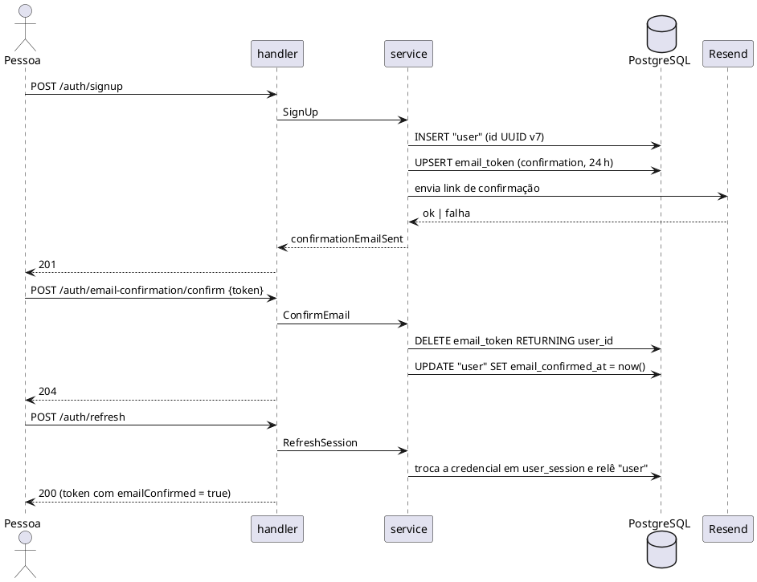

# Design — contas

## Abordagem

O contexto nasce no serviço `art-books` (Go, módulo `github.com/Arthur-155/art-books`,
binário em `backend/art-books/`, HTTP na porta `:8080`, PostgreSQL), no pacote
`backend/domain/contas/` com `//gofi:context contas`, nas camadas do SDK:
`entity`, `repository`, `service` (`contas_service.go` para conta, e-mail e
papel; `auth_service.go` para login, sessão e senha, sob uma interface
`ContasService` única), `handler` (`contas_handler.go` e `auth_handler.go`),
mais `mailer` (cliente do Resend) e `worker` (expurgo). Contas é a primeira
gênese do serviço: cria a tabela `"user"` que `catalogo` e `recomendacoes` usam
como FK.

A sessão tem duas peças: o token de acesso do SDK (JWT, TTL e `JWT_SECRET`
padrão do SDK), com o id do usuário, o papel (`user` | `admin`) e o indicador
de e-mail confirmado (REQ-04, REQ-15), e uma credencial de renovação opaca,
guardada só como hash em `user_session`, que vale 30 dias (`REFRESH_TOKEN_TTL`
= 720 h) e é trocada a cada renovação (REQ-07). Renovar relê a linha do
usuário, por isso a confirmação do e-mail e a mudança de papel valem na
renovação seguinte. Encerrar sessões é apagar linhas de `user_session`: a do
dispositivo no logout (REQ-08), todas as do usuário na recuperação e na troca
de senha, na troca de e-mail e na exclusão (REQ-09–12).
Encerrar as sessões impede a renovação na hora; o token de acesso já emitido
segue válido até vencer, no TTL padrão do SDK, e a requisição autenticada não
consulta o banco (ADR-05).

Os links de e-mail levam um token aleatório de 32 bytes em base64url; o banco
guarda só o SHA-256 dele (REQ-17), em `email_token`, uma linha por usuário e
finalidade: emitir de novo substitui a linha e invalida o link anterior
(REQ-03, REQ-11.8). Usar o link é `DELETE … WHERE token_hash = $1 AND
expires_at > now() RETURNING …` — sem linha devolvida, o link é inválido ou
vencido, sem distinguir os casos (REQ-02, REQ-09, REQ-11). A senha é guardada
com argon2id (`golang.org/x/crypto/argon2`, parâmetros m = 19 MiB, t = 2,
p = 1, sal de 16 bytes, no formato PHC) e comparada em tempo constante (ADR-02).

O envio de e-mail é síncrono, pela API HTTP do Resend, atrás da interface
`Mailer` (ADR-03): a operação grava o token, envia e, se o envio falha,
devolve `ErrContasEmailDeliveryFailed` sem desfazer a conta nem o token — o
usuário pede de novo (REQ-14). No cadastro a conta já existe, então a resposta
é `201` com `confirmationEmailSent: false` (REQ-14.1).



### Troca de e-mail (REQ-11)

| Passo | Finalidade em `email_token` | Prazo | Enviado a | Efeito |
|---|---|---|---|---|
| Pedido | `email_change_approval`, com `new_email` | 1 h | e-mail atual | apaga as duas finalidades da troca antes de gravar (REQ-11.8) |
| Aprovação | `email_change_confirmation`, com `new_email` | 24 h | novo e-mail | consome a aprovação; o e-mail da conta não muda |
| Confirmação | — | — | — | `UPDATE "user" SET email = new_email`, `email_confirmed_at = now()`; apaga as sessões e os outros tokens do usuário |

Se o envio da confirmação ao novo e-mail falha na aprovação, a transação que consome o token de aprovação sofre rollback e o mesmo link vale até o prazo (REQ-14.3, REQ-14.4). O novo e-mail é conferido contra `"user"` no pedido e na aprovação; na
confirmação, a restrição `uq_user_email` decide (REQ-11.7). O login sempre lê
`"user".email`, por isso o e-mail atual vale até a confirmação (REQ-11.5).

### Limites (REQ-06, REQ-13)

- Login: `login_lock` tem uma linha por chave (`email` ou `ip`). Cada erro faz
  `INSERT … ON CONFLICT DO UPDATE`: se a janela começou há mais de 15 min,
  recomeça com 1; senão soma 1; ao chegar a 5, grava `locked_until = now() +
  15 min` e zera a contagem. Antes de conferir a senha, o login recusa com
  `ErrContasLoginLocked` se alguma das duas chaves tem `locked_until > now()`.
  Login certo apaga a linha da chave `email`. A chave do e-mail é o valor
  informado, normalizado, exista a conta ou não (REQ-06.4).
- Pedidos de e-mail: `email_request` guarda um registro por pedido aceito, exista ou não a conta (a recusa por excesso é igual nos dois casos, REQ-09.7),
  com o tipo e a chave. O pedido é recusado com `ErrContasTooManyRequests` se
  a chave tem registro do mesmo tipo no último minuto ou 5 na última hora. No
  reenvio e na troca de e-mail a chave `email` é o e-mail atual da conta; na
  recuperação, o e-mail informado.
- O IP é o do cliente como o servidor HTTP do SDK o resolve atrás do
  balanceador (o primeiro endereço de `X-Forwarded-For` vindo de proxy
  confiável).
- O cadastro e o uso do link de aprovação não passam por esse limite (REQ-13).
- A checagem e o registro não são atômicos entre si: dois pedidos simultâneos
  podem passar juntos. É aceito: o limite protege a cota do Resend e a conta,
  não exige exatidão.

### Expurgo

O `worker.PurgeWorker`, no binário `art-books`, roda a cada 1 h
`service.PurgeExpired`: apaga `user_session` e `email_token` vencidos,
`email_request` com mais de 1 h e `login_lock` sem bloqueio vigente e com
janela de mais de 15 min.

### Comando operacional (REQ-15)

`art-books admin grant <e-mail>` e `art-books admin revoke <e-mail>`: o
`main.go` despacha o subcomando antes de subir o HTTP, abre a mesma conexão e
chama `service.GrantAdmin` / `service.RevokeAdmin`, que fazem
`UPDATE "user" SET role = … WHERE email = lower($1)`. Sem linha afetada, sai
com código 1 e "conta não encontrada" (REQ-15.3). Nenhuma rota HTTP escreve
`role`.

### Configuração

| Variável | Uso |
|---|---|
| `APP_BASE_URL` | base dos links de e-mail (`{APP_BASE_URL}/confirmar-email?token=…`, `/redefinir-senha?token=…`, `/aprovar-troca-de-email?token=…`, `/confirmar-novo-email?token=…`) |
| `RESEND_API_KEY` | autenticação na API do Resend |
| `RESEND_FROM_EMAIL` | remetente dos e-mails |
| `REFRESH_TOKEN_TTL` | 720 h (variável Auth do SDK) |

As três primeiras são novas e fora do padrão do SDK; ausentes, o binário não
sobe. Os caminhos dos links são o contrato com a mudança de interface.

## Modelo de dados

Perfil de acesso: `"user"` é cold na maior parte, com UPDATE leve (confirmação,
troca de senha, e-mail e papel); `user_session`, `email_token`, `login_lock` e
`email_request` são hot DELETE+INSERT com expurgo de vencidos. `"user".id` é
`UUID` gerado pelo `service` com `uuid.NewV7()` (`github.com/google/uuid`
≥ v1.6.0) antes de `Save`; as FKs para ele são `UUID` com `ON DELETE CASCADE`
nas tabelas do contexto, o que realiza a exclusão de sessões e tokens com a
conta (REQ-12). As outras tabelas usam `BIGINT IDENTITY`. Isolamento
`ReadCommitted`; a unicidade é das restrições nomeadas.

E-mail e username entram em minúsculas e sem espaços nas pontas, normalizados
no `service`; o `CHECK` garante no banco. A unicidade sem diferenciar caixa
vem disso (ADR-01).

```sql
-- 0001_create_user.up.sql
CREATE TABLE "user" (
    id                  UUID        PRIMARY KEY,
    email               TEXT        NOT NULL CHECK (email = lower(btrim(email)) AND length(email) BETWEEN 3 AND 254),
    username            TEXT        NOT NULL CHECK (username ~ '^[a-z0-9_]{3,30}$'),
    display_name        TEXT        NOT NULL CHECK (length(btrim(display_name)) BETWEEN 1 AND 60),
    password_hash       TEXT        NOT NULL,
    role                TEXT        NOT NULL DEFAULT 'user' CHECK (role IN ('user','admin')),
    email_confirmed_at  TIMESTAMPTZ NULL,
    terms_accepted_at   TIMESTAMPTZ NOT NULL,
    age_declared_at     TIMESTAMPTZ NOT NULL,
    created_at          TIMESTAMPTZ NOT NULL DEFAULT now(),
    updated_at          TIMESTAMPTZ NOT NULL DEFAULT now(),
    CONSTRAINT uq_user_email UNIQUE (email),
    CONSTRAINT uq_user_username UNIQUE (username)
);
```

```sql
-- 0001_create_user.down.sql
DROP TABLE IF EXISTS "user";
```

```sql
-- 0002_create_user_session.up.sql
CREATE TABLE user_session (
    id          BIGINT GENERATED ALWAYS AS IDENTITY PRIMARY KEY,
    user_id     UUID        NOT NULL REFERENCES "user"(id) ON DELETE CASCADE,
    token_hash  BYTEA       NOT NULL,
    expires_at  TIMESTAMPTZ NOT NULL,
    created_at  TIMESTAMPTZ NOT NULL DEFAULT now(),
    CONSTRAINT uq_user_session_token_hash UNIQUE (token_hash)
);
CREATE INDEX ix_user_session_user_id ON user_session (user_id);
CREATE INDEX ix_user_session_expires_at ON user_session (expires_at);
```

```sql
-- 0002_create_user_session.down.sql
DROP TABLE IF EXISTS user_session;
```

```sql
-- 0003_create_email_token.up.sql
CREATE TABLE email_token (
    id          BIGINT GENERATED ALWAYS AS IDENTITY PRIMARY KEY,
    user_id     UUID        NOT NULL REFERENCES "user"(id) ON DELETE CASCADE,
    purpose     TEXT        NOT NULL CHECK (purpose IN ('email_confirmation','password_reset','email_change_approval','email_change_confirmation')),
    token_hash  BYTEA       NOT NULL,
    new_email   TEXT        NULL CHECK (new_email = lower(btrim(new_email))),
    expires_at  TIMESTAMPTZ NOT NULL,
    created_at  TIMESTAMPTZ NOT NULL DEFAULT now(),
    CONSTRAINT uq_email_token_user_id_purpose UNIQUE (user_id, purpose),
    CONSTRAINT uq_email_token_token_hash UNIQUE (token_hash),
    CONSTRAINT ck_email_token_new_email CHECK ((purpose LIKE 'email_change_%') = (new_email IS NOT NULL))
);
CREATE INDEX ix_email_token_expires_at ON email_token (expires_at);
```

```sql
-- 0003_create_email_token.down.sql
DROP TABLE IF EXISTS email_token;
```

```sql
-- 0004_create_request_limit.up.sql
CREATE TABLE login_lock (
    key_kind           TEXT        NOT NULL CHECK (key_kind IN ('email','ip')),
    key_value          TEXT        NOT NULL,
    failure_count      SMALLINT    NOT NULL DEFAULT 0,
    window_started_at  TIMESTAMPTZ NOT NULL DEFAULT now(),
    locked_until       TIMESTAMPTZ NULL,
    PRIMARY KEY (key_kind, key_value)
);
CREATE TABLE email_request (
    id            BIGINT GENERATED ALWAYS AS IDENTITY PRIMARY KEY,
    request_type  TEXT        NOT NULL CHECK (request_type IN ('confirmation_resend','password_reset','email_change')),
    key_kind      TEXT        NOT NULL CHECK (key_kind IN ('email','ip')),
    key_value     TEXT        NOT NULL,
    requested_at  TIMESTAMPTZ NOT NULL DEFAULT now()
);
CREATE INDEX ix_email_request_key ON email_request (request_type, key_kind, key_value, requested_at);
```

```sql
-- 0004_create_request_limit.down.sql
DROP TABLE IF EXISTS email_request;
DROP TABLE IF EXISTS login_lock;
```

Entidades (`entity`): `User{ID, Email, Username, DisplayName, PasswordHash string; Role Role; EmailConfirmedAt *time.Time; TermsAcceptedAt, AgeDeclaredAt, CreatedAt, UpdatedAt time.Time}`,
`Session{ID int64; UserID string; TokenHash []byte; ExpiresAt time.Time}`,
`EmailToken{UserID string; Purpose TokenPurpose; TokenHash []byte; NewEmail *string; ExpiresAt time.Time}`.
`Role` e `TokenPurpose` são `string` com as constantes da migração. Funções
puras em `entity`: `NormalizeEmail`, `NormalizeUsername`, `IsValidUsername`.

Contrato do repositório (`ContasRepository`): `SaveUser(ctx, *User) error`
(`ErrContasEmailTaken` / `ErrContasUsernameTaken` pelo nome da restrição,
SQLSTATE 23505), `FindUserByID(ctx, string) (*User, error)`,
`FindUserByEmail(ctx, string) (*User, error)`, `IsEmailTaken(ctx, string) (bool, error)`,
`MarkEmailConfirmed(ctx, userID string) error`, `UpdatePasswordHash(ctx, userID, hash string) error`,
`UpdateEmail(ctx, userID, email string) error`, `SetRoleByEmail(ctx, email string, role Role) error`,
`DeleteUser(ctx, userID string) error`, `SaveSession(ctx, *Session) error`,
`RotateSession(ctx, oldHash []byte, *Session) (*Session, error)` (apaga a antiga e grava a nova na mesma transação; sem linha antiga no prazo, `ErrContasInvalidSession`),
`DeleteSession(ctx, tokenHash []byte) error`, `DeleteUserSessions(ctx, userID string) error`,
`ReplaceEmailToken(ctx, *EmailToken) error`, `ConsumeEmailToken(ctx, purpose TokenPurpose, tokenHash []byte) (*EmailToken, error)`,
`DeleteEmailTokens(ctx, userID string, purposes ...TokenPurpose) error`,
`FindPendingEmailChange(ctx, userID string) (*string, error)`,
`IsLoginLocked(ctx, keys []LimitKey) (bool, error)`, `RecordLoginFailure(ctx, LimitKey) error`,
`ClearLoginFailures(ctx, LimitKey) error`, `CountEmailRequests(ctx, RequestType, LimitKey, since time.Time) (int, error)`,
`RecordEmailRequest(ctx, RequestType, []LimitKey) error`, `PurgeExpired(ctx, now time.Time) error`.

## Contratos

Rotas públicas no grupo `/api/v1/auth`; as de `/api/v1/account` exigem
autenticação (401 sem token válido).
A sessão viaja em cookies `HttpOnly; Secure; SameSite=Lax` (ADR-06):
`access_token` (`Path=/`, vida do token de acesso) e `refresh_token`
(`Path=/api/v1/auth`, 30 dias). O login e a renovação os definem; o logout, a
troca de senha, a recuperação, a troca de e-mail e a exclusão os expiram.
Renovação e logout leem a credencial do cookie `refresh_token`.

| Operação | Rota ou evento | Auth | Requisitos | Respostas |
|---|---|---|---|---|
| Cadastrar | `POST /api/v1/auth/signup` `{email, password, displayName, username, termsAccepted, ageDeclared}` | pública | REQ-01, REQ-02, REQ-14, REQ-15 | 201 `{confirmationEmailSent}` · 400 · 409 |
| Confirmar e-mail | `POST /api/v1/auth/email-confirmation/confirm` `{token}` | pública | REQ-02 | 204 · 400 |
| Entrar | `POST /api/v1/auth/login` `{email, password}` | pública | REQ-04, REQ-05, REQ-06 | 200 sessão · 400 · 401 · 429 |
| Renovar sessão | `POST /api/v1/auth/refresh` | credencial de renovação | REQ-04, REQ-07, REQ-15 | 200 sessão · 401 |
| Sair | `POST /api/v1/auth/logout` | credencial de renovação | REQ-08 | 204, mesmo sem credencial válida |
| Pedir recuperação | `POST /api/v1/auth/password-reset/request` `{email}` | pública | REQ-09, REQ-13 | 202 · 400 · 429 |
| Redefinir senha | `POST /api/v1/auth/password-reset/confirm` `{token, newPassword}` | pública | REQ-09 | 204 · 400 |
| Aprovar troca de e-mail | `POST /api/v1/auth/email-change/approve` `{token}` | pública | REQ-11, REQ-14 | 202 · 400 · 409 · 502 |
| Confirmar novo e-mail | `POST /api/v1/auth/email-change/confirm` `{token}` | pública | REQ-11 | 204 · 400 · 409 |
| Consultar a conta | `GET /api/v1/account` | autenticado | REQ-16 | 200 · 401 |
| Reenviar confirmação | `POST /api/v1/account/email-confirmation/resend` | autenticado | REQ-03, REQ-13, REQ-14 | 202 · 401 · 409 · 429 · 502 |
| Trocar senha | `PUT /api/v1/account/password` `{currentPassword, newPassword}` | autenticado | REQ-10 | 204 · 400 · 401 · 422 |
| Pedir troca de e-mail | `POST /api/v1/account/email-change` `{newEmail}` | autenticado | REQ-11, REQ-13, REQ-14 | 202 · 400 · 401 · 409 · 429 · 502 |
| Excluir a conta | `DELETE /api/v1/account` `{password}` | autenticado | REQ-12 | 204 · 401 · 422 |
| Conceder / retirar administrador | `art-books admin grant\|revoke <e-mail>` | operador, na base | REQ-15 | código 0 · 1 |

- Sessão (login e renovação): os dois cookies e, no corpo,
  `{user: {id, username, displayName, role, emailConfirmed}}`; os tokens nunca
  vão no corpo.
- Conta: `{id, email, username, displayName, role, emailConfirmed, pendingEmail | null}`.
  Nenhuma rota devolve o e-mail de outra conta (REQ-16).
- Validação na borda: `email` `required,max=254` e aceito por `net/mail.ParseAddress` só quando o resultado é igual ao informado (sem nome nem comentário); `password` e
  `newPassword` `required`, de 8 a 128 caracteres (`utf8.RuneCountInString`), e o argon2id recebe a senha inteira, sem truncar;
  `displayName` `required` e 1 a 60 caracteres depois de `TrimSpace`;
  `username` `required` e `^[a-zA-Z0-9_]{3,30}$` antes de ir para minúsculas;
  `termsAccepted` e `ageDeclared` `required,eq=true`; `token` `required,max=64`.
  Campo desconhecido no corpo é ignorado, o que inclui um `role` no cadastro
  (REQ-15.4).
- Recuperação: `202` com a mesma mensagem exista ou não a conta (REQ-09.2).
  Se o envio pelo Resend falha com a conta existente, a resposta continua a
  mesma e a falha vai só para o log: dar erro revelaria que o e-mail existe.
  A mensagem orienta pedir de novo se o e-mail não chegar. Nas demais rotas
  de e-mail, a falha é `502` (REQ-14).

## Erros

| Erro | Situação | Requisito |
|---|---|---|
| `ErrContasInvalidInput` (400) | campo fora da validação da borda | REQ-01, REQ-09, REQ-10, REQ-11 |
| `ErrContasEmailTaken` (409) | `uq_user_email` violada, ou novo e-mail já em uso na troca | REQ-01, REQ-11 |
| `ErrContasUsernameTaken` (409) | `uq_user_username` violada | REQ-01 |
| `ErrContasInvalidLink` (400) | token de link inexistente, já usado ou vencido, sem distinguir | REQ-02, REQ-09, REQ-11 |
| `ErrContasInvalidCredentials` (401) | e-mail inexistente ou senha errada no login, mesma mensagem | REQ-05 |
| `ErrContasLoginLocked` (429) | chave `email` ou `ip` com bloqueio vigente | REQ-06 |
| `ErrContasInvalidSession` (401) | credencial de renovação inexistente, já usada ou vencida | REQ-07 |
| `ErrContasEmailAlreadyConfirmed` (409) | reenvio com o e-mail já confirmado | REQ-03 |
| `ErrContasWrongPassword` (422) | senha atual errada na troca de senha ou na exclusão | REQ-10, REQ-12 |
| `ErrContasTooManyRequests` (429) | limite de pedidos de e-mail atingido | REQ-13 |
| `ErrContasEmailDeliveryFailed` (502) | o Resend recusou ou não respondeu em 10 s | REQ-14 |
| `ErrContasUserNotFound` | conta inexistente no comando operacional (código de saída 1) | REQ-15 |

Falha do Resend é registrada no log com o tipo do e-mail e o id do usuário,
nunca com o token nem o endereço.

## Mapa de requisitos

| Requisito | Componente |
|---|---|
| REQ-01 | `service.SignUp`, `handler.SignUp`, `entity.NormalizeEmail`, `entity.NormalizeUsername`, `repository.SaveUser` (`uq_user_email`, `uq_user_username`) |
| REQ-02 | `service.SignUp`, `service.ConfirmEmail`, `repository.ConsumeEmailToken`, `handler.ConfirmEmail` |
| REQ-03 | `service.ResendConfirmation`, `repository.ReplaceEmailToken`, `handler.ResendConfirmation` |
| REQ-04 | `service.issueSession` (claim de e-mail confirmado), `service.RefreshSession` |
| REQ-05 | `service.Login`, `handler.Login` |
| REQ-06 | `service.Login`, `repository.IsLoginLocked`, `repository.RecordLoginFailure`, `repository.ClearLoginFailures` |
| REQ-07 | `service.RefreshSession`, `repository.RotateSession`, `handler.Refresh` |
| REQ-08 | `service.Logout`, `repository.DeleteSession`, `handler.Logout` |
| REQ-09 | `service.RequestPasswordReset`, `service.ResetPassword`, `repository.DeleteUserSessions` |
| REQ-10 | `service.ChangePassword`, `handler.ChangePassword` |
| REQ-11 | `service.RequestEmailChange`, `service.ApproveEmailChange`, `service.ConfirmEmailChange`, `repository.UpdateEmail` |
| REQ-12 | `service.DeleteAccount`, `repository.DeleteUser` (FKs `ON DELETE CASCADE`), `handler.DeleteAccount` |
| REQ-13 | `service.checkEmailRequestLimit`, `repository.CountEmailRequests`, `repository.RecordEmailRequest` |
| REQ-14 | `mailer.ResendMailer`, `service.SignUp`, `service.ResendConfirmation`, `service.RequestEmailChange`, `service.ApproveEmailChange` |
| REQ-15 | `service.GrantAdmin`, `service.RevokeAdmin`, `repository.SetRoleByEmail`, subcomando `admin` em `backend/art-books/main.go` |
| REQ-16 | `service.GetAccount`, `handler.GetAccount`, `repository.FindPendingEmailChange` |
| REQ-17 | `service.hashPassword` (argon2id), `service.hashToken` (SHA-256), `repository.SaveUser`, `repository.ReplaceEmailToken` |

Testes: `entity/user_test.go` (normalização e regra do username),
`service/contas_service_test.go` e `service/auth_service_test.go` (com
`Mailer` falso e relógio injetado para 24 h, 30 min, 1 h, 15 min e 30 dias),
`repository/contas_repository_test.go` (PostgreSQL real: unicidade sem
diferenciar caixa, cadastro simultâneo do REQ-01.8, consumo único de token,
`ON DELETE CASCADE`), `handler/contas_handler_test.go` e
`handler/auth_handler_test.go` (códigos HTTP e mesma resposta no REQ-05.2 e no
REQ-09.2), `mailer/resend_mailer_test.go` (servidor HTTP falso),
`worker/purge_worker_test.go`.

## Decisões

### ADR-01 — Unicidade pelo valor normalizado guardado

**Contexto:** e-mail e username são únicos sem diferenciar caixa. · **Decisão:** guardar os dois já em minúsculas e sem espaços nas pontas, com `CHECK` no banco e `UNIQUE` simples nomeado, em vez de `citext` ou índice em `lower(…)`. · **Consequências:** a restrição nomeada resolve o cadastro simultâneo e o repositório discrimina o conflito pelo nome; perde-se a caixa original do e-mail, sem efeito na entrega.

### ADR-02 — argon2id para a senha, SHA-256 para os tokens

**Contexto:** a senha pede hash forte (REQ-17); os tokens de link e de renovação são aleatórios de 32 bytes. · **Decisão:** argon2id com m = 19 MiB, t = 2, p = 1 para a senha; SHA-256 para os tokens, que têm entropia alta e precisam de busca exata pelo hash. · **Consequências:** o custo do argon2id fica só no login, na troca de senha e na exclusão; a senha tem teto de 128 caracteres para limitar esse custo.

### ADR-03 — Envio síncrono atrás de `Mailer`

**Contexto:** a falha no envio precisa virar erro claro na hora (REQ-14) e o projeto não tem fila nem broker. · **Decisão:** o `service` chama `Mailer.Send` na própria requisição, com timeout de 10 s; a única implementação é `ResendMailer`. · **Consequências:** sem outbox nem retentativa automática, o usuário pede de novo; a interface com uma implementação se paga no teste, que troca o Resend por um falso sem rede.

### ADR-04 — Limites em tabelas do PostgreSQL

**Contexto:** bloqueio de login e limite de pedidos de e-mail, por e-mail e por IP, sem Redis no projeto. · **Decisão:** `login_lock` com contador e `locked_until`, e `email_request` com um registro por pedido, ambos expurgados a cada hora. · **Consequências:** nenhuma infraestrutura nova; checagem e registro não são atômicos, e dois pedidos simultâneos podem passar do limite por um.

### ADR-05 — Papel e e-mail confirmado no token

**Contexto:** `catalogo` (ADR-04 dele) e os demais contextos leem papel e e-mail confirmado sem consultar `contas`. · **Decisão:** o token de acesso leva `sub` = id do usuário, `role` e `emailConfirmed`, relidos de `"user"` a cada login e renovação. · **Consequências:** confirmação de e-mail e mudança de papel só valem na próxima renovação. Como a requisição autenticada não consulta o banco, o token de acesso já emitido sobrevive ao encerramento das sessões até vencer; só a renovação é recusada na hora. É a janela aceita para não pôr uma consulta em toda requisição do sistema.

### ADR-06 — Sessão em cookies HTTP-only

**Contexto:** a plataforma é web responsiva e o token não deve ficar ao alcance de script da página. · **Decisão:** token de acesso e credencial de renovação em cookies `HttpOnly; Secure; SameSite=Lax`, o de renovação restrito a `/api/v1/auth`; os tokens não vão no corpo. · **Consequências:** o front não lê nem guarda token; `SameSite=Lax` com corpo JSON barra o envio entre sites das operações que mudam estado, sem token CSRF; um cliente não web precisaria de outro transporte.
