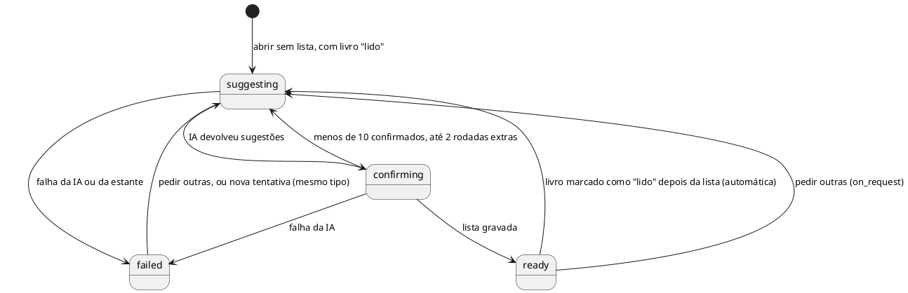

# Design — recomendacoes

## Abordagem

O contexto nasce no serviço `art-books` (Go, módulo `github.com/Arthur-155/art-books`,
binário em `backend/art-books/`, HTTP `:8080`, PostgreSQL), no pacote
`backend/domain/recomendacoes/` com `//gofi:context recomendacoes`, nas camadas
do SDK: `entity`, `repository`, `service`, `handler`, mais `worker` (geração em
segundo plano), `generator` (cliente da IA) e `gateway` (adaptadores para a
estante e o catálogo). Autenticação é a do SDK (JWT); do token vêm o id do
usuário e o indicador de e-mail confirmado emitidos por `contas`.

A lista é uma linha por usuário em `recommendation_list`, cujo estado é a fila
da geração, como a pesquisa do catálogo (ADR-03). Abrir as recomendações é
síncrono: lê a lista e a estante e, se não há lista ou se um livro foi marcado
como "lido" depois dela (ADR-01), põe a lista em `suggesting` e responde na
hora. O `worker`, no mesmo binário, busca a cada 5 s as listas pendentes,
reserva cada uma com `FOR UPDATE SKIP LOCKED` e concessão de 5 min, e gera:
pede sugestões à IA, confirma cada livro, guarda o resumo breve e grava a
lista inteira numa transação. Adicionar, dispensar, pedir outras e tentar de
novo são operações síncronas do `service`.



### Geração (REQ-01–03, REQ-11)

Passos de `service.GenerateRecommendations`, chamado pelo worker com a lista reservada:

1. `ShelfGateway.ListShelfBooks(userID)` — todos os livros da estante. Os
   "lidos" são a base (título, autor, gênero); o maior `MarkedReadAt` deles é
   guardado como `based_on_read_at`. Sem livro "lido" nesse momento, a geração
   termina em `ready` sem mudar os itens e sem contar no limite.
2. Exclusões: chaves normalizadas (`catalogo/entity.NormalizeBookText` em
   título e autor) de todos os livros da estante, em qualquer estado, e de
   `recommendation_dismissal` do usuário (REQ-01.2, REQ-01.3).
3. Rodada: `RecommendationGenerator.SuggestBooks` com os "lidos" e a
   quantidade que falta; o prompt leva as exclusões (até as 200 mais recentes)
   e os itens da lista atual como livros a evitar. A resposta é filtrada no
   `service`, nunca confiada: título ou autor vazio, chave excluída, chave já
   escolhida ou descartada nesta geração saem (REQ-01.4). Estado → `confirming`.
4. Confirmação de cada sugestão restante, até 5 em paralelo: com
   `book_brief` para a chave, o livro conta como confirmado e o resumo é
   reaproveitado sem chamar a IA (REQ-03.3); sem, `ConfirmBook` (Claude com a
   ferramenta de busca na web do servidor da Anthropic, saída estruturada
   `{exists, summary}`). `exists=false` descarta (REQ-11.1); resumo vazio ou
   com mais de 1.000 caracteres (`utf8.RuneCountInString`) descarta (REQ-03.2);
   confirmado, `INSERT … ON CONFLICT DO NOTHING` em `book_brief`.
5. Menos de 10 confirmados: nova rodada pelo passo 3, no máximo 2 extras
   (`MAX_EXTRA_SUGGESTION_ROUNDS = 2`); depois, segue com o que houver (REQ-11.2, REQ-11.3).
6. `SaveGeneratedList`, numa transação: apaga os itens do usuário, insere os
   novos em ordem (o `INSERT … SELECT` ignora chave dispensada durante a
   geração), grava `ready`, `based_on_read_at`, `generated_at`, limpa
   `next_attempt_at` e, se a geração é `on_request`, soma 1 em
   `recommendation_daily_usage` no `requested_on` (REQ-09, REQ-10).

O motivo vem de `SuggestBooks`, uma frase por livro (REQ-02); resposta sem
motivo descarta a sugestão.

### Falha (REQ-08)

Falha = erro de rede, HTTP 5xx/429, timeout de 60 s por chamada, resposta fora
do formato, ou erro do `ShelfGateway`. Qualquer falha encerra a geração em
`failed`, com `next_attempt_at = NULL`, sem tocar nos itens e sem contar no
limite; o log leva o id do usuário, o tipo da geração e o passo. Não há nova
tentativa automática: só `POST …/retry` volta a `suggesting`, com o mesmo
`generation_kind` e o mesmo `requested_on` (REQ-10.4). Abrir as
recomendações com a lista em `failed` não inicia geração (REQ-08.4). O
processo que cai no meio deixa a concessão vencer, e o worker retoma a mesma
geração do passo 1 — não é geração nova. A falha fica no worker e nas tabelas
deste contexto: catálogo e estante seguem atendendo (REQ-08.3).

### Limite diário (REQ-10)

O dia é a data em `America/Sao_Paulo` (`time.LoadLocation`, com
`_ "time/tzdata"` no binário), pelo relógio injetado no `service`.
`DAILY_REQUEST_LIMIT = 5`. Pedir outras lê `request_count` de hoje; com 5,
recusa. A soma só acontece no `SaveGeneratedList` de uma geração
`on_request`, no dia em que o pedido foi feito (`requested_on`). Uma geração
por usuário de cada vez (o `UPDATE` condicional de `RequestMore` e `Retry`)
garante que o contador não passa de 5.

### Adicionar e dispensar (REQ-05, REQ-06)

`AddToShelf(userID, recommendationID)`: lê o item por `(id, user_id)`;
`CatalogGateway.FindBookByKey` pelas chaves normalizadas; sem livro,
`CatalogGateway.RegisterBook` com o título e o autor do item e o indicador de
e-mail confirmado do token — a regra e o erro são os do catálogo
(`ErrCatalogEmailNotConfirmed`, REQ-05.3), e o registro inicia a pesquisa de
gênero de lá. Depois `ShelfGateway.AddWantToRead(userID, bookID)`, que não
duplica nem muda o estado de livro já na estante (REQ-05.4), e só então apaga
o item. As chamadas são idempotentes; se uma falha, o item fica e o usuário
repete.

`Dismiss(userID, recommendationID)`: numa transação, `INSERT … ON CONFLICT DO
NOTHING` em `recommendation_dismissal` com as chaves do item e `DELETE` do item.

## Modelo de dados

Perfil de acesso: `recommendation_list` é hot UPDATE (o estado muda várias
vezes por geração) — `fillfactor = 80`, só o índice parcial do worker;
`recommendation` é reescrita em bloco a cada geração e lida pelo usuário;
`recommendation_dismissal` e `book_brief` são append-only, lidas por chave;
`recommendation_daily_usage` é uma linha por usuário e dia. Chaves de
usuário são `UUID` com `ON DELETE CASCADE`: as recomendações são pessoais e
somem com a conta. Isolamento `ReadCommitted`; unicidade pelas restrições.

```sql
-- 0001_create_recommendation_list.up.sql
CREATE TABLE recommendation_list (
    user_id           UUID        PRIMARY KEY REFERENCES "user"(id) ON DELETE CASCADE,
    status            TEXT        NOT NULL
        CHECK (status IN ('suggesting','confirming','ready','failed')),
    generation_kind   TEXT        NOT NULL CHECK (generation_kind IN ('automatic','on_request')),
    requested_on      DATE        NULL,
    based_on_read_at  TIMESTAMPTZ NULL,
    next_attempt_at   TIMESTAMPTZ NULL,
    generated_at      TIMESTAMPTZ NULL,
    created_at        TIMESTAMPTZ NOT NULL DEFAULT now(),
    updated_at        TIMESTAMPTZ NOT NULL DEFAULT now()
) WITH (fillfactor = 80);
CREATE INDEX ix_recommendation_list_pending ON recommendation_list (next_attempt_at)
    WHERE status IN ('suggesting','confirming');
```

```sql
-- 0001_create_recommendation_list.down.sql
DROP TABLE IF EXISTS recommendation_list;
```

```sql
-- 0002_create_recommendation.up.sql
CREATE TABLE recommendation (
    id                 BIGINT GENERATED ALWAYS AS IDENTITY PRIMARY KEY,
    user_id            UUID        NOT NULL REFERENCES "user"(id) ON DELETE CASCADE,
    position           SMALLINT    NOT NULL CHECK (position BETWEEN 1 AND 10),
    title              TEXT        NOT NULL CHECK (length(title) <= 300),
    author             TEXT        NOT NULL CHECK (length(author) <= 200),
    title_normalized   TEXT        NOT NULL,
    author_normalized  TEXT        NOT NULL,
    reason             TEXT        NOT NULL CHECK (char_length(reason) BETWEEN 1 AND 300),
    created_at         TIMESTAMPTZ NOT NULL DEFAULT now(),
    CONSTRAINT uq_recommendation_user_id_title_normalized_author_normalized
        UNIQUE (user_id, title_normalized, author_normalized)
);
```

```sql
-- 0002_create_recommendation.down.sql
DROP TABLE IF EXISTS recommendation;
```

```sql
-- 0003_create_recommendation_dismissal.up.sql
CREATE TABLE recommendation_dismissal (
    user_id            UUID        NOT NULL REFERENCES "user"(id) ON DELETE CASCADE,
    title_normalized   TEXT        NOT NULL,
    author_normalized  TEXT        NOT NULL,
    dismissed_at       TIMESTAMPTZ NOT NULL DEFAULT now(),
    CONSTRAINT pk_recommendation_dismissal PRIMARY KEY (user_id, title_normalized, author_normalized)
);
```

```sql
-- 0003_create_recommendation_dismissal.down.sql
DROP TABLE IF EXISTS recommendation_dismissal;
```

```sql
-- 0004_create_book_brief.up.sql
CREATE TABLE book_brief (
    title_normalized   TEXT        NOT NULL,
    author_normalized  TEXT        NOT NULL,
    summary            TEXT        NOT NULL CHECK (char_length(summary) BETWEEN 1 AND 1000),
    created_at         TIMESTAMPTZ NOT NULL DEFAULT now(),
    CONSTRAINT pk_book_brief PRIMARY KEY (title_normalized, author_normalized)
);
```

```sql
-- 0004_create_book_brief.down.sql
DROP TABLE IF EXISTS book_brief;
```

```sql
-- 0005_create_recommendation_daily_usage.up.sql
CREATE TABLE recommendation_daily_usage (
    user_id        UUID     NOT NULL REFERENCES "user"(id) ON DELETE CASCADE,
    usage_date     DATE     NOT NULL,
    request_count  SMALLINT NOT NULL CHECK (request_count BETWEEN 0 AND 5),
    CONSTRAINT pk_recommendation_daily_usage PRIMARY KEY (user_id, usage_date)
);
```

```sql
-- 0005_create_recommendation_daily_usage.down.sql
DROP TABLE IF EXISTS recommendation_daily_usage;
```

- `next_attempt_at` é a fila: `now()` ao entrar em `suggesting`; o worker grava
  `now() + 5 min` ao reservar; `NULL` em `ready` e `failed`.
- `recommendation` não guarda o resumo: o item lê `book_brief` por JOIN nas
  chaves, o que faz um resumo valer para todos (REQ-03.3, ADR-02).
- Linhas antigas de `recommendation_daily_usage` ficam: uma por usuário e dia
  de uso, sem varredura agendada.

Entidades (`entity`): `RecommendationList{UserID string; Status ListStatus; GenerationKind GenerationKind; RequestedOn *time.Time; BasedOnReadAt, NextAttemptAt, GeneratedAt *time.Time; CreatedAt, UpdatedAt time.Time}`,
`Recommendation{ID int64; UserID string; Position int16; Title, Author, TitleNormalized, AuthorNormalized, Reason string; CreatedAt time.Time}`,
`RecommendationView` (o item com `Summary` do JOIN), `BookBrief{TitleNormalized, AuthorNormalized, Summary string}`.
`ListStatus` e `GenerationKind` são `string` com as constantes acima.

Contrato do repositório (`RecommendationRepository`): `FindList(ctx, userID) (*RecommendationList, error)`,
`ListRecommendations(ctx, userID) ([]RecommendationView, error)`, `FindRecommendation(ctx, userID string, id int64) (*Recommendation, error)`,
`StartGeneration(ctx, GenerationStart) (bool, error)` (insere ou faz o `UPDATE` condicional a `status IN ('ready','failed')`; `false` = geração em andamento),
`ClaimPendingLists(ctx, limit int, lease time.Duration) ([]RecommendationList, error)`, `UpdateListStatus(ctx, userID string, status ListStatus) error`,
`SaveGeneratedList(ctx, GeneratedList) error`, `MarkListFailed(ctx, userID string) error`, `ListDismissedKeys(ctx, userID) ([]BookKey, error)`,
`DismissRecommendation(ctx, userID string, id int64) error`, `DeleteRecommendation(ctx, userID string, id int64) error`,
`FindBookBriefs(ctx, []BookKey) (map[BookKey]string, error)`, `InsertBookBriefIfAbsent(ctx, BookBrief) error`,
`FindDailyRequestCount(ctx, userID string, day time.Time) (int, error)`.

## Contratos

Todas as rotas exigem autenticação (401 sem token válido, REQ-12.2) e operam
só sobre o usuário do token.

| Operação | Rota ou evento | Auth | Requisitos | Respostas |
|---|---|---|---|---|
| Abrir as recomendações | `GET /api/v1/recommendations` | autenticado | REQ-01, REQ-02, REQ-03, REQ-04, REQ-07, REQ-08, REQ-10, REQ-12 | 200 |
| Pedir outras | `POST /api/v1/recommendations/refresh` | autenticado | REQ-09, REQ-10, REQ-07 | 202 · 409 · 422 · 429 |
| Tentar de novo | `POST /api/v1/recommendations/retry` | autenticado | REQ-08 | 202 · 409 |
| Adicionar à estante | `POST /api/v1/recommendations/{id}/shelf` | autenticado | REQ-05, REQ-12 | 200 · 400 · 403 · 404 |
| Dispensar | `POST /api/v1/recommendations/{id}/dismiss` | autenticado | REQ-06, REQ-12 | 204 · 400 · 404 |

- Corpo de `GET`, também devolvido por `refresh` e `retry`:
  `{status, items: [{id, title, author, reason, summary}], requestMore: {used, limit, available, blockedReason}}`.
  `status` é `no_read_books` (sem lista e sem livro "lido", REQ-07), `suggesting`
  ou `confirming` (o passo visível, REQ-01), `ready` ou `failed` (REQ-08).
  `items` vem em `position`, vazio em `no_read_books`; em `failed` e durante a
  geração, traz a lista anterior, se houver. `blockedReason` é
  `daily_limit_reached`, `generation_in_progress`, `no_read_books` ou `null`
  — é o que a tela usa para desligar o botão com a explicação (REQ-10.1).
  Os textos de cada estado são da interface.
- `GET` sem lista e com livro "lido" chama `StartGeneration` `automatic` e
  responde `suggesting`; com lista `ready` e um "lido" posterior a
  `based_on_read_at`, também (REQ-04.1). Em `failed`, não (REQ-08.4).
- Adicionar devolve `{bookId}`, o livro do catálogo que entrou na estante.
- Validação na borda: `{id}` inteiro positivo; as rotas `POST` não têm corpo.

### Interfaces consumidas

Definidas em `service` deste contexto e implementadas em `gateway`:

- `ShelfGateway` — `ListShelfBooks(ctx, userID string) ([]ShelfBook, error)`, com
  `ShelfBook{BookID int64; Title, Author string; GenreName *string; ReadingStatus string; MarkedReadAt *time.Time}`,
  e `AddWantToRead(ctx, userID string, bookID int64) error`, que não duplica nem
  muda o estado de livro já na estante. Implementada sobre o `service` de
  `leitura-e-resumos`, que a gênese dele expõe.
- `CatalogGateway` — `FindBookByKey(ctx, titleNormalized, authorNormalized string) (*int64, error)`
  sobre `catalogo/repository.CatalogRepository.FindBookByNormalizedKey`, e
  `RegisterBook(ctx, Requester, title, author string) (int64, error)` sobre
  `catalogo/service.RegisterBook`.
- `RecommendationGenerator` — `SuggestBooks(ctx, SuggestionRequest) ([]Suggestion, error)`
  e `ConfirmBook(ctx, title, author string) (BookConfirmation, error)`; única
  implementação `AnthropicRecommendationGenerator`, com `ANTHROPIC_API_KEY` e
  `ANTHROPIC_MODEL`, as mesmas do catálogo, sem variável nova.

## Erros

| Erro | Situação | Requisito |
|---|---|---|
| `ErrRecommendationNotFound` (404) | item inexistente ou de outro usuário ao adicionar ou dispensar | REQ-05, REQ-06, REQ-12 |
| `ErrRecommendationNoReadBooks` (422) | pedir outras sem nenhum livro "lido" | REQ-07 |
| `ErrRecommendationGenerationInProgress` (409) | pedir outras ou tentar de novo com a lista em `suggesting` ou `confirming` | REQ-09 |
| `ErrRecommendationDailyLimitReached` (429) | pedir outras com 5 pedidos contados hoje | REQ-10 |
| `ErrRecommendationNotFailed` (409) | tentar de novo com a lista fora de `failed` | REQ-08 |
| `ErrCatalogEmailNotConfirmed` (403) | adicionar livro fora do catálogo sem e-mail confirmado, repassado do catálogo | REQ-05 |

Falha da IA não vira erro HTTP: o worker grava `failed` e registra no log
(REQ-08); o usuário a vê no `status` do `GET`.

## Mapa de requisitos

| Requisito | Componente |
|---|---|
| REQ-01 | `service.OpenRecommendations`, `service.GenerateRecommendations`, `worker.GenerationWorker`, `generator.AnthropicRecommendationGenerator.SuggestBooks`, `handler.OpenRecommendations` |
| REQ-02 | `generator.AnthropicRecommendationGenerator.SuggestBooks`, `service.GenerateRecommendations` |
| REQ-03 | `generator.AnthropicRecommendationGenerator.ConfirmBook`, `repository.InsertBookBriefIfAbsent`, `repository.FindBookBriefs` (`pk_book_brief`) |
| REQ-04 | `service.OpenRecommendations` (`based_on_read_at` × `MarkedReadAt`), `gateway.ShelfGateway.ListShelfBooks` |
| REQ-05 | `service.AddToShelf`, `handler.AddToShelf`, `gateway.CatalogGateway`, `gateway.ShelfGateway.AddWantToRead` |
| REQ-06 | `service.Dismiss`, `handler.Dismiss`, `repository.DismissRecommendation` (`pk_recommendation_dismissal`) |
| REQ-07 | `service.OpenRecommendations`, `service.RequestMore` |
| REQ-08 | `worker.GenerationWorker`, `repository.MarkListFailed`, `service.Retry`, `handler.Retry` |
| REQ-09 | `service.RequestMore`, `handler.RequestMore`, `repository.StartGeneration`, `repository.SaveGeneratedList` |
| REQ-10 | `service.RequestMore` (fuso `America/Sao_Paulo`), `repository.FindDailyRequestCount`, `repository.SaveGeneratedList` |
| REQ-11 | `service.GenerateRecommendations` (rodadas extras), `generator.AnthropicRecommendationGenerator.ConfirmBook` |
| REQ-12 | `handler` (usuário do token), `repository.FindRecommendation` por `(id, user_id)` |

Testes: `service/recommendation_service_test.go` (com `RecommendationGenerator`,
`ShelfGateway` e `CatalogGateway` falsos e relógio injetado para a virada do
dia em `America/Sao_Paulo`), `worker/generation_worker_test.go` (falha,
concessão vencida, rodadas extras), `repository/recommendation_repository_test.go`
(PostgreSQL real: `StartGeneration` simultâneo, dispensa durante a geração,
contagem do limite), `handler/recommendation_handler_test.go`.

## Decisões

### ADR-01 — Nova lista por comparação de datas, sem evento de Leitura

**Contexto:** REQ-04 pede nova lista quando um livro é marcado como "lido", e a estante é de outro contexto. · **Decisão:** a lista guarda `based_on_read_at`, o maior `MarkedReadAt` dos "lidos" usados; ao abrir, um "lido" posterior inicia a geração automática. · **Consequências:** Leitura não conhece Recomendações e nenhuma IA é chamada para quem não abre a tela; remover um "lido" não muda o máximo, o que realiza REQ-04.3; custa ler a estante a cada abertura.

### ADR-02 — Resumo breve em tabela própria por chave normalizada

**Contexto:** a sugestão pode ser de livro fora do catálogo, e `book` é do catálogo, cuja mudança ainda não foi aprovada. · **Decisão:** `book_brief`, chave título e autor normalizados, escrita só por este contexto, vale para livro do catálogo ou não. · **Consequências:** uma fonte única de resumo e nenhum delta no catálogo; o resumo não aparece na consulta do livro do catálogo.

### ADR-03 — Fila da geração na própria lista, sem nova tentativa automática

**Contexto:** a geração é longa (várias chamadas à IA) e a falha deve dar ao usuário a nova tentativa. · **Decisão:** o estado de `recommendation_list` é a fila, no padrão do worker do catálogo; a falha vai a `failed` e só o usuário reinicia. · **Consequências:** sem broker, uma geração por usuário garantida pelo `UPDATE` condicional, e custo de IA só quando o usuário age; o usuário espera o intervalo do worker, de até 5 s.

### ADR-04 — Estante, catálogo e IA atrás de interfaces deste contexto

**Contexto:** a estante e o catálogo são de outros contextos, ainda sem código, e o provedor de IA deve ser trocável, como no catálogo. · **Decisão:** `ShelfGateway`, `CatalogGateway` e `RecommendationGenerator` definidos em `service`, cada um com uma implementação. · **Consequências:** o `service` testa com falsos e não importa os pacotes dos outros contextos; custa três interfaces de uma implementação cada, justificadas pela fronteira entre contextos e pela troca de provedor já planejada.

### ADR-05 — A falha mantém a lista anterior

**Contexto:** a falha da IA não pode deixar o usuário sem nada (PRD §6, risco "Tela sem sugestões"). · **Decisão:** a geração só substitui os itens no `SaveGeneratedList`; em `failed` e durante a geração, o `GET` devolve a lista anterior junto do estado. · **Consequências:** o usuário segue adicionando e dispensando enquanto tenta de novo; a tela precisa distinguir lista atual de lista em atualização pelo `status`.
